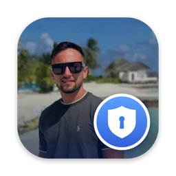
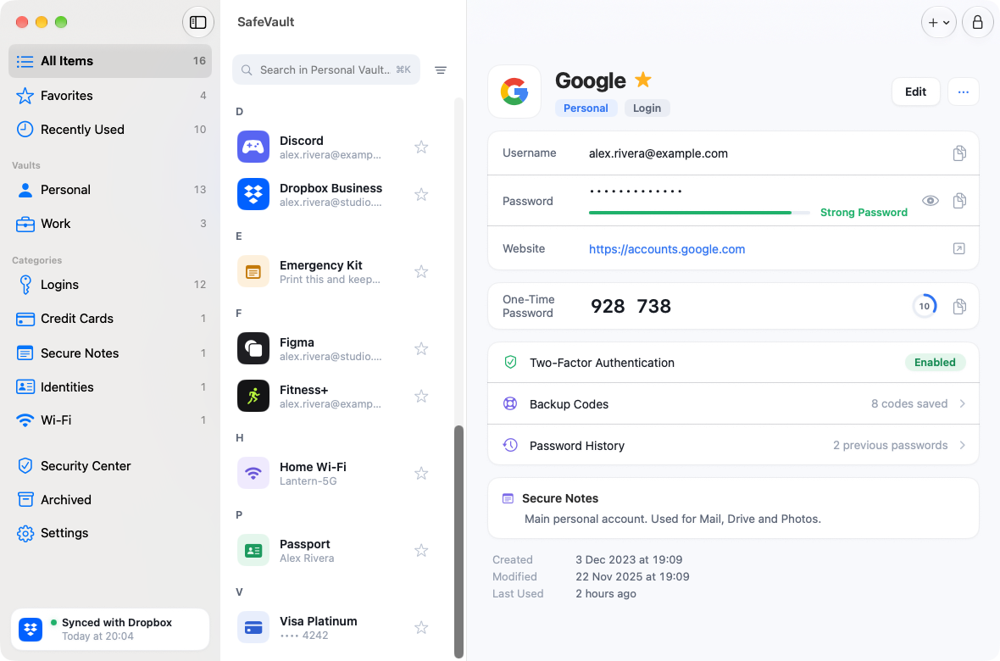
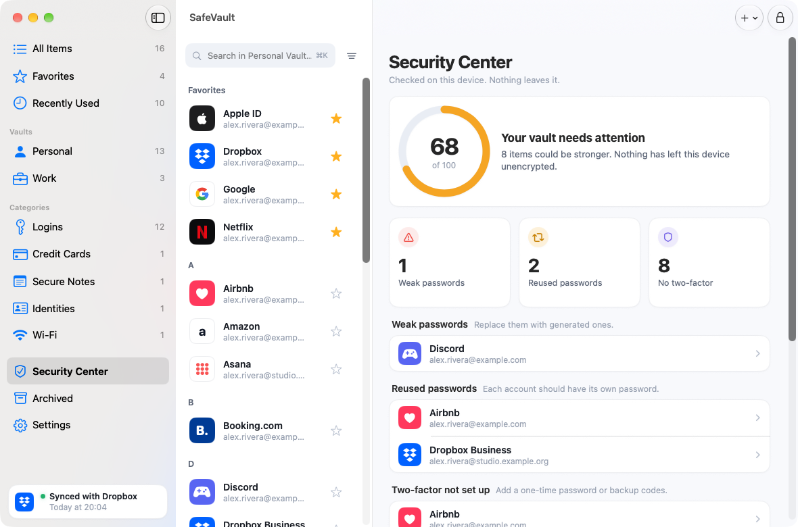

<div align="center">



# SafeVault

**A private, zero-knowledge password manager for Mac and iPhone.** 🔐
Native SwiftUI · encrypted on your devices · synced through *your own* iCloud Drive, Dropbox or Google Drive · free, no limits.


</div>

---

## ✨ Why

Most password managers want a subscription for the one thing that matters: using your passwords on **both** your Mac and your phone.
SafeVault does that for free. Your vault is encrypted on the device, and the only thing that ever reaches your cloud is ciphertext. No accounts, no servers, no telemetry. 🚫📡

## 📸 A look

<div align="center">


</div>

<sub>Fictional demo data.</sub>

## 🧰 Features

- 🔑 **Logins, cards, secure notes, identities and Wi-Fi**, with favorites, vaults (Personal / Work), tags and an archive
- 🔢 **Built-in 2FA codes** (TOTP, RFC 6238) with a live countdown, plus backup codes
- 🕘 **Password history** and **version history**: nothing you overwrite is lost
- 🛡️ **Security Center**: weak, reused and no-two-factor checks, computed on the device
- 🪄 **Password generator** with length and character options
- 😀 **Face ID** on iPhone and **Touch ID** on Mac (with the master password always as a fallback)
- ☁️ **iCloud Drive, Dropbox *or* Google Drive sync** (you choose, and can switch), offline-first, with safe conflict handling
- 📥 **Import from Safe (SafeInCloud)**: straight from its `.db` file, or from an XML / CSV export
- 🖼️ **Automatic site logos**: fetched from each entry's own website and stored in the vault, or pick your own image
- 💾 **Encrypted backups** you can export and restore
- ⏱️ **Auto-lock**, hidden in the app switcher, clipboard cleared after 30 seconds

## 🔒 How it protects your data

| | |
|---|---|
| 🧂 **Key derivation** | Master password → PBKDF2-HMAC-SHA256 (600,000 rounds, random salt) |
| 🗝️ **Vault key** | A random 256-bit key, wrapped by the master password (changing the password never re-encrypts your items) |
| 🧱 **Encryption** | One AES-256-GCM record per item, bound to its id so records cannot be swapped |
| ☁️ **In your cloud** | **One file, `vault.db`**, in a folder only SafeVault can use: the vault header plus one AES-256-GCM sealed blob with every item. Nothing readable |
| 😀 **Biometrics** | Face ID / Touch ID guard a copy of the vault key in the Keychain (invalidated if biometrics change). The master password is asked again every 7 days |
| 🚨 **Recovery** | **There is none, on purpose.** Forget the master password and nobody can read your data. Export an encrypted backup |

## 🔄 Sync, and what happens on a conflict

Edit the same item on two devices while offline? **The most recent edit wins and the other version is kept in that item's history. Nothing is silently discarded.**
Deletions travel as scrubbed tombstones, a `vault.db` removed by hand is uploaded again, and a `vault.db` that cannot be read is **never overwritten**. Vaults left by older versions (one file per item) are merged into `vault.db` and the old files are deleted only once `vault.db` is confirmed to hold everything. An unchanged vault is not even downloaded when polling.
Sync runs after each change, when the app returns to the foreground, and every minute while open.

> ⚠️ A cloud refuses new files when the account is over its quota. SafeVault then says *"Dropbox is full"* (or Google Drive), keeps working on the device, and syncs again once you free space. A free second account just for the vault is plenty: it only needs a few MB.

## 📥 Coming from Safe (SafeInCloud)?

In SafeVault go to **Settings → Import from Safe…** and pick either:

- 🗄️ **`SafeInCloud.db`** straight from your Dropbox folder (usually `Dropbox/Apps/Safe In Cloud/`). You type your Safe master password once, it is used to read the file and then forgotten. The original is never changed or deleted
- 📄 an **XML** (preferred) or **CSV** export. That file is *not encrypted*, so the app offers to delete it afterwards

You always get a preview before anything is imported. Duplicates are skipped and anything that does not map cleanly is kept as a plain field, with a warning.
Generic `name,url,username,password` CSVs from other managers work too.

## 🚀 Run it

```bash
git clone https://github.com/donebyfreddy/SafeVault.git
cd SafeVault
open MyVault.xcodeproj        # schemes: MyVault-macOS and MyVault-iOS
```

The Xcode project is generated from [`project.yml`](project.yml) with [XcodeGen](https://github.com/yonaskolb/XcodeGen) (`brew install xcodegen`, then `xcodegen generate`).

### 📱 On your iPhone, for free

You only need a free Apple ID. The catch: apps signed with a free account **stop opening after 7 days** and need to be installed again (your data stays as long as you do not delete the app).

1. iPhone: *Settings → Privacy & Security → Developer Mode → On* (it restarts). Connect it with a cable and tap **Trust**.
2. Xcode: *Settings → Accounts → +* and sign in with your Apple ID.
3. Select the **MyVault-iOS** target → *Signing & Capabilities* → Team: your name (*Personal Team*).
4. Pick your iPhone as destination and press **Run**. The first time, trust the developer in *Settings → General → VPN & Device Management*.

If Xcode says the bundle identifier is taken, change `com.federicomencuccini.myvault` in `project.yml` to something unique and run `xcodegen generate`.

### 💻 On your Mac

Press **Run** with the **MyVault-macOS** scheme, or build a release DMG with `tools/release.sh`.
The app is ad-hoc signed and not notarized (that needs the paid Apple Developer Program), so macOS may show *"Apple could not verify…"* the first time for a downloaded copy. Click **OK**, then *System Settings → Privacy & Security → Open Anyway*, or run once:

```bash
xattr -dr com.apple.quarantine "/Applications/SafeVault.app"
```

Touch ID on the Mac needs a team-signed build (add the *Keychain Sharing* capability in Xcode). Without it the app still works with the master password.

### ☁️ Connect Dropbox (one time)

SafeVault logs in with **OAuth 2 + PKCE in your browser**. The app never sees your Dropbox password, and no client secret is used. You create a tiny Dropbox app of your own:

1. Open the [Dropbox App Console](https://www.dropbox.com/developers/apps/create) → **Create app** → *Scoped access* → **App folder** → any name.
2. *Permissions*: tick `files.metadata.read`, `files.content.read`, `files.content.write` → **Submit**.
3. *Settings*: leave *Allow public clients (PKCE)* on **Allow**. Copy the **App key** (never the App secret) and paste it into SafeVault (the *One-time Dropbox setup* box).
4. SafeVault then shows a redirect URI like `db-<APP_KEY>://2/token`. Add it under **Redirect URIs** in the console.
5. Press **Connect Dropbox**. On your second device choose *I already have a vault in Dropbox*.

### 🍎 Sync with iCloud Drive (no accounts, no keys)

Pick **iCloud Drive** in *Settings → Sync with* and choose a folder: in **Files** (iPhone) or **Finder** (Mac) create a folder in iCloud Drive, for example `SafeVault`, and select it. Do the same on your other device and pick **the same folder**. Both need iCloud Drive turned on. SafeVault keeps its encrypted files there and iCloud carries them across. It works with any folder that Files shows, so a Dropbox or Google Drive folder works too.

If iCloud makes a "name 2.vitem" copy because two devices wrote at the same moment, SafeVault merges it in (the other version goes to that item's history) and moves the copy to a `Resolved conflicts` folder inside yours. Nothing is deleted.

### 🟢 Connect Google Drive (one time, optional alternative to Dropbox)

Pick **Google Drive** in *Settings → Sync with*. SafeVault only asks for the **non-sensitive `drive.appdata` scope**: a hidden folder of its own in your Drive, nothing else. Login is OAuth 2 + PKCE in your browser, no client secret.

1. In [Google Cloud Console](https://console.cloud.google.com/projectcreate) create a project (any name) and enable the **Google Drive API** (*APIs & Services → Library*).
2. *OAuth consent screen* (Google Auth Platform): user type **External**, app name SafeVault. Add the scope `https://www.googleapis.com/auth/drive.appdata`, then **Publish app**. Otherwise Google signs you out every 7 days. No review is needed for a non-sensitive scope.
3. *Credentials → Create credentials → OAuth client ID*, application type **iOS**, bundle ID `com.federicomencuccini.myvault` (or yours, if you changed it). Copy the **Client ID**.
4. Paste the Client ID into SafeVault (the *One-time Google Drive setup* box) and press **Connect Google Drive**. No redirect address needs registering: it is derived from the client ID.

Switching between Dropbox and Google Drive uploads your vault to the new one and merges anything already there, so nothing is lost or duplicated.

## 🧱 Project layout

```
Packages/MyVaultKit    🧠 crypto, vault storage, sync engine, Dropbox and Google Drive clients, importers, site logos, TOTP (98 unit tests, including a 2,000-item speed test)
App/Shared             🎨 SwiftUI shared by Mac and iPhone (theme, models, item views, settings, security)
App/macOS              🖥️ three-column Mac layout
App/iOS                📱 iPhone home and custom tab bar
tools/                 🛠️ release.sh (build + package + clean up), make-icon.sh (app icon, optionally from your photo)
project.yml            ⚙️ XcodeGen project definition
```

## 🧪 Tests

```bash
cd Packages/MyVaultKit && swift test
```

Covers crypto (known vectors, tampering, wrong password), TOTP (RFC 6238 vectors), vault storage, two simulated devices syncing through a fake Dropbox (offline, conflicts, deletions, damaged files), the Dropbox client with stubbed HTTP, and the Safe importers.
Debug builds accept the launch argument `--demo` to run with fictional data.

## 🗺️ Limits and what is next

- ✍️ **No autofill into Safari and other apps yet.** It needs an AutoFill credential provider extension, the natural next step
- 🧩 The Safe `.db` reader follows the documented file layout and is tested with files generated to that layout, **not yet with a large range of real Safe databases**. If a file is rejected, export XML from Safe instead and please open an issue with the error
- ☁️ Dropbox and Google Drive sync are verified against a simulated cloud and stubbed HTTP, not yet at scale against live accounts. Google Drive has no "write only if unchanged" call, so an update checks the file version first and then writes; a collision at the very same instant from two devices is merged on the next sync
- 🌙 Light mode only. No sharing, iPad, Apple Watch or attachments yet

## 🙏 Credits and notes

- Not affiliated with Safe / SafeInCloud, Dropbox or Apple. Product names belong to their owners
- The Safe database layout was learned from the open-source decrypter [evilsocket/SafeInCloud](https://github.com/evilsocket/SafeInCloud) (GPLv3). The code here is an independent implementation
- No license has been chosen yet, so by default all rights are reserved. Add one if you want others to reuse the code

<div align="center">

Made with ☕ and a lot of `swift test`.

</div>
